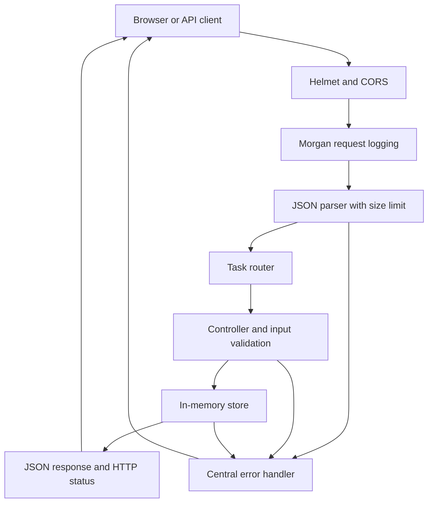

# TaskFlow API

**SoftNexis Full Stack Web Development — Task 3: Backend API with Node.js/Express**

A small REST API for TaskFlow, with a connected task-manager page. Tasks are stored on the server instead of in localStorage. The interface supports creation, completion, deletion with confirmation, filters, counts, dark/light mode, and refreshing the shared list. The API also supports renaming task text.

**Repository:** https://github.com/Kaushiki809/taskflow-api

**Deployment status:** Source published to GitHub. Hosting is intentionally deferred; there is no public live deployment yet. Run the app locally with the steps below. GitHub Pages cannot execute this Node.js backend.

## Scope and storage

The Task 3 brief explicitly specifies an **in-memory data store**, with a database introduced in the next task. Tasks survive page reloads and are shared between clients connected to the same server process. They disappear when that process stops, restarts, or is redeployed. There is no browser task storage and no database in this project.

This is a shared learning demo without user authentication or per-user permissions. Anyone who can reach it can read and change the list. Use sample tasks only. CORS restricts browser access from other origins; it is not authentication. Multiple server instances would have separate lists. Database durability and authentication are outside this assignment's implementation.

## Run locally

Install **Node.js 24 LTS** (includes npm), then:

```sh
git clone https://github.com/Kaushiki809/taskflow-api.git
cd taskflow-api
npm ci
npm start
```

Open **http://localhost:5000** for the connected frontend, **http://localhost:5000/api/tasks** for task JSON, and **http://localhost:5000/health** for a health check.

No build step, database, API keys, or paid services are required. The server starts with an empty list. Use `npm run dev` to restart automatically after source edits. Stop it with Ctrl+C.

Optional configuration: copy `.env.example` to `.env` and edit it. Node loads this file at startup; the real `.env` is excluded from Git.

| Variable | Default | Purpose |
| --- | --- | --- |
| `PORT` | `5000` | Server listening port |
| `NODE_ENV` | unset (local development) | Set to `production` behind an HTTPS hosting proxy |
| `CORS_ORIGINS` | Kaushiki's GitHub Pages origin and local port 5000 origins | Comma-separated cross-origin browser clients |

The bundled frontend uses relative `/api/tasks` requests and is served by Express on the same origin. The existing Task 2 repository remains a separate localStorage demonstration; this Task 3 repository contains the server-connected version.

## API contract

Send JSON with `Content-Type: application/json` on POST and PUT. Successful task responses use the task object below; lists are arrays. All errors have the shape `{ "error": "Readable message" }`.

| Method | Endpoint | Request body | Success | Common errors |
| --- | --- | --- | --- | --- |
| GET | `/api/tasks` | none | 200, array of tasks (newest first) | 500 |
| GET | `/api/tasks/:id` | none | 200, one task | 400 invalid ID, 404 missing task |
| POST | `/api/tasks` | `{ "text": "Read a chapter" }` | 201, task and Location header | 400, 409 demo capacity, 413, 415 |
| PUT | `/api/tasks/:id` | `{ "text": "New text", "completed": true }` or either field | 200, updated task | 400, 404, 413, 415 |
| DELETE | `/api/tasks/:id` | none | 204, empty body | 400, 404 |
| GET | `/health` | none | 200, service status | 500 |

PUT accepts partial updates to match the assignment examples. Omitted values retain their existing values. An empty update is rejected. IDs and creation timestamps are read-only.

```json
{
  "id": 1,
  "text": "Read a chapter",
  "completed": false,
  "createdAt": "2026-10-19T05:00:00.000Z"
}
```

### Validation and safety

- Text must be a non-empty string, trimmed and normalized to Unicode NFC, at most 140 UTF-16 code units (matching the TaskFlow Lite input limit). Control characters are rejected.
- Completion must be an actual boolean. Unknown fields, arrays, empty updates, malformed JSON, and invalid IDs are rejected.
- IDs must be positive safe integers without suffixes or leading zeros. IDs are generated by the server and are not reused during the process lifetime.
- JSON bodies are limited to 10 KB; the demo store is capped at 1,000 tasks.
- Helmet supplies security headers. Morgan logs method, URL, status, and duration without request bodies.
- The frontend uses `textContent` for task input; HTML-like text is displayed literally. Input is not inserted as executable HTML.
- Unexpected errors return a generic 500 response; stack traces are not returned to clients.
- Only an explicit list of frontend assets is served. Server source, `.env`, tests, and package files are not public routes.

## Small, modular architecture

Files are kept at the root for easy navigation, with separate modules for routes, controllers, validation, storage, and error middleware.

```text
server.js       Start, environment loading, port binding, graceful shutdown
app.js          Express setup, middleware pipeline, public asset allowlist
task-routes.js  REST endpoints and JSON content-type checks
task-controller.js  Request/response handling
validation.js   Body validation, normalization, strict ID parsing
store.js        Isolated in-memory task store
errors.js       HTTP error class and centralized error handler
index.html      Connected TaskFlow interface
client.js       Fetch requests, UI events, loading and error feedback
render.js       Safe DOM rendering
model.js        Pure filter/count helpers
styles.css      Responsive layout and color themes
icon.svg        App icon
tests.mjs       Automated HTTP integration tests
TaskFlow.postman_collection.json  Importable request collection
.env.example    Safe configuration example
package.json / package-lock.json  Scripts and locked dependencies
```



The app factory creates a fresh store per instance and accepts a replacement store for testing. This makes a future database adapter straightforward and lets tests simulate a server error without exposing a dangerous public debug route.

## Tests

```sh
npm test
```

The tests start isolated HTTP servers on temporary local ports and shut them down afterward. **Eight automated tests pass**, covering:

1. All five endpoints, response schema, Location header, partial/full updates, 204 deletion and subsequent 404s.
2. Empty input, text length boundaries, invalid types, unknown fields, and control characters.
3. Invalid IDs, missing resources, unknown routes, and source/config-file non-exposure.
4. Malformed JSON (400), oversized bodies (413), and unsupported content types (415).
5. Allowed/disallowed browser origins, preflight, Helmet headers, no-cache task responses, and health check.
6. A deliberately failing injected store that returns a sanitized 500 error. The single `synthetic test failure` log line during testing is expected.
7. Creating 100 unique tasks, completing 50, deleting 60, persistence across requests, and a new process-equivalent app starting empty.
8. Frontend assets and HTML-like input remaining ordinary JSON text.

“All endpoints covered” refers to exercising all five task routes, not a measured 100% code-line coverage score. Dependency installation reported zero known npm vulnerabilities at the time of verification. No OWASP ZAP scan, load-test score, or independent security audit is claimed.

### Postman

1. Start the local server.
2. Import `TaskFlow.postman_collection.json` into Postman.
3. Keep collection variable `baseUrl` set to `http://localhost:5000`.
4. Run the 18 requests in order using the Collection Runner.

The collection captures the generated task ID, checks creation/retrieval/updates, exercises validation/CORS/404 cases, and deletes only its own sample task. The 500 failure case is covered in `tests.mjs` through dependency injection instead of a public failure endpoint. The Postman collection is provided for reproduction; the automated Node HTTP tests are the executed test suite.

### Browser checks

Open the local interface, add a sample task, complete it, refresh the page, and verify the task and completion remain. Check the filters. Cancel a deletion once, then confirm it. Open the same server in a second tab and click **Refresh tasks** to see the shared list. Restart the server to confirm the documented in-memory reset. The UI reports failed network requests instead of pretending changes were saved.

## Deploy later

Use a Node-capable web host; **do not enable GitHub Pages** for this backend.

Example Render settings:

- Repository: `https://github.com/Kaushiki809/taskflow-api`
- Branch: `main`
- Runtime: Node, with Node 24 selected by `package.json`
- Build command: `npm ci`
- Start command: `npm start`
- Environment: `NODE_ENV=production`; set `CORS_ORIGINS` if using a separate frontend origin
- Optional HTTP health check: `/health`

The server binds to `0.0.0.0` and reads the hosting provider's `PORT`. SIGTERM/SIGINT close the server with a bounded shutdown timeout. Run one instance while using this in-memory store. Hosting restarts or idle shutdowns erase the demo list. Select an account and plan before deployment; no hosting resource has been created for this project.

## Assignment checklist

| Deliverable | Included |
| --- | --- |
| Node.js/Express source | Modular API and connected frontend |
| CORS, logging, security headers | cors, morgan, helmet |
| CRUD and HTTP conventions | Five endpoints and consistent JSON errors |
| Validation/sanitization | Type checks, trimming/NFC, length and control-character checks |
| Server-side data storage | In-memory store as specified for Task 3 |
| Postman collection | 18 ordered requests with assertions |
| Automated endpoint checks | Eight passing HTTP integration tests |
| Server configuration | Environment example, PORT handling, graceful shutdown |
| Documentation | Setup, schemas, architecture, tests, limitations, deployment steps |

Swagger/OpenAPI, load testing, API versioning, rate limiting, authentication, and database integration are not included in this minimal implementation. Before using it for real personal data, add authentication, authorization, persistent storage, abuse protection, and a security review.
